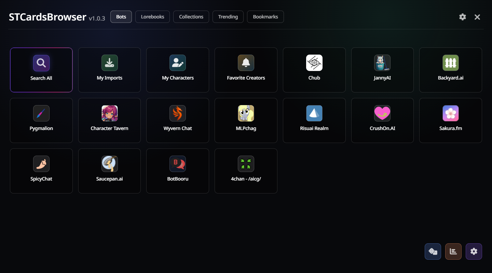
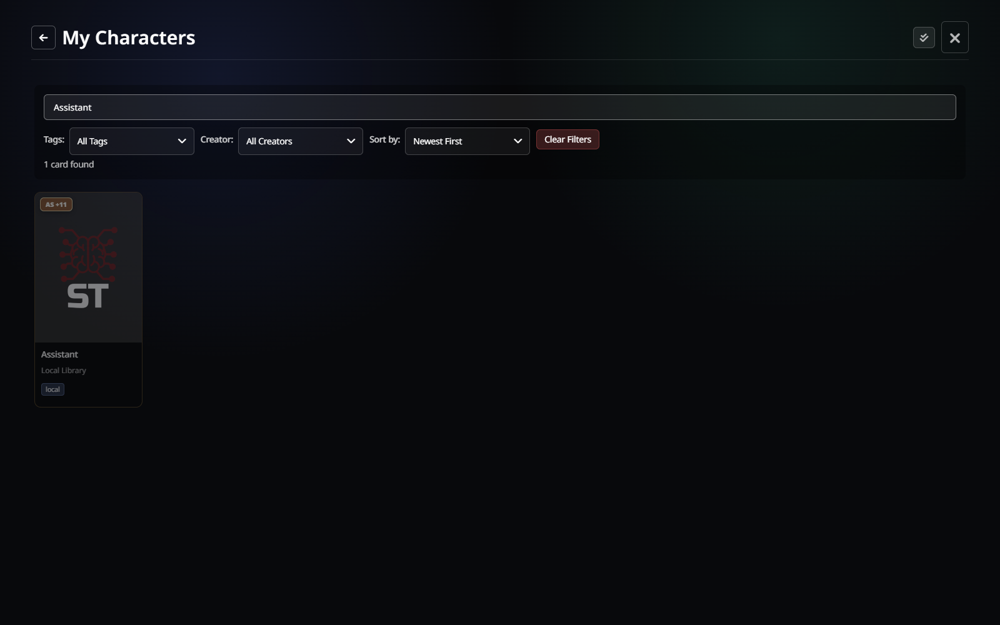
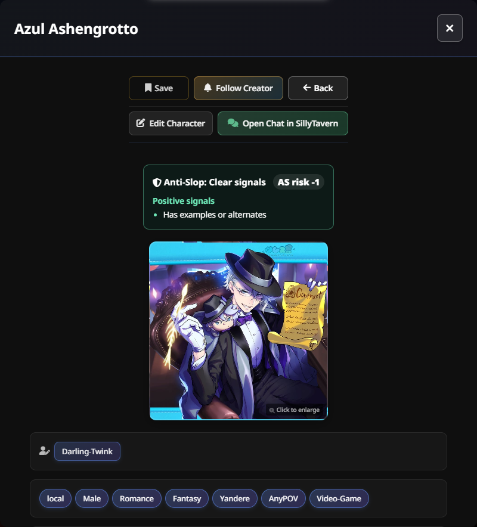
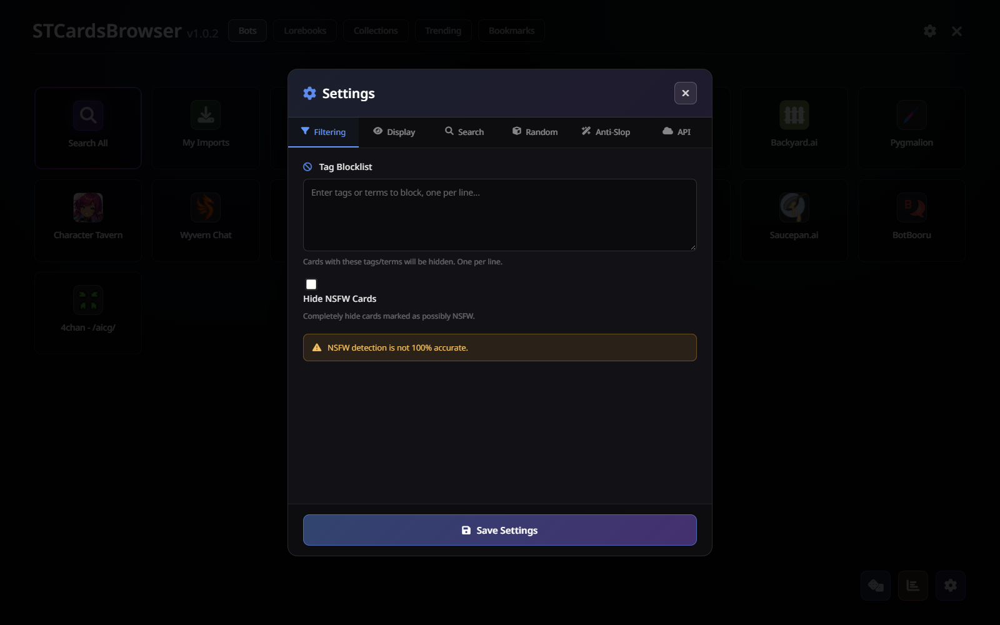

# STCardsBrowser

**STCardsBrowser** is a full-screen card browser for [SillyTavern](https://github.com/SillyTavern/SillyTavern). Discover character cards, lorebooks, collections, trends, and your local library without leaving the app.

> This is an independently maintained fork of BotBrowser. The legacy remote archive/iframe path has been removed. Third-party integrations can change or become unavailable; review the source and use the extension at your own discretion.

## What's new in 1.0.3

- **SpicyChat integration:** browse without an account, search, filter by tags or creator, and navigate cached result pages.
- **Full card imports:** load available definitions and original greetings when opening details or importing. Hidden definitions are clearly marked as partial imports; failed detail requests do not import incomplete previews.
- **SpicyChat controls:** filter SFW/NSFW content or show only open definitions; sort by 24-hour trends, message count, rating, or date.
- **Mobile navigation fix:** dynamic viewport sizing and safe-area padding keep the bottom action buttons clear of Android navigation, including browsers that report zero bottom inset.
- **Import compatibility:** correctly match imported character filenames returned by SillyTavern.
- **QuillGen key handling:** account keys are no longer added to card URLs; imports use an authorization header only for the QuillGen HTTPS origin.

## Highlights

- Browse characters, lorebooks, collections, and trends in one full-screen interface.
- Search multiple live sources at once, with source-aware filters and NSFW controls.
- Inspect cards in detail, open galleries and creator information, then import or update characters.
- Keep bookmarks, favorite creators, recently viewed cards, and your local SillyTavern library close at hand.
- Use dedicated views for local characters and World Info, including editors and direct chat navigation.
- Designed for desktop and mobile layouts, with safe-area spacing for system navigation.

## Screenshots and demos

  

<em>Choose a source, including SpicyChat, open the local library, or search across supported sources.</em>

  

<em>Search, filter, and sort your local SillyTavern character library.</em>

  

<em>Inspect a card, edit local characters, save it, or open a chat directly.</em>

  

<em>Configure filtering, display, search, randomization, anti-slop, and API behavior.</em>

## Install

1. In SillyTavern, open **Extensions → Install extension** and paste `https://github.com/Nulliik/STCardsBrowser`.
2. Reload SillyTavern.
3. Click the card-browser icon beside the character import controls to open STCardsBrowser.

To update an existing installation, use SillyTavern's extension update control, then reload the page to load the new scripts and styles.

## What you can browse

| Area | Includes |
| --- | --- |
| Characters | Live sources, Search All, AI Finder, and your local character library |
| Lorebooks | Live lorebook sources and local World Info files |
| Trending | Separate trending feeds from supported services |
| Saved content | Bookmarks, recently viewed cards, and favorite creators |

## Search and safety

- Use **Search All** when the source does not matter.
- Add `+tag` to require a tag or `-tag` to exclude one.
- Apply source-specific filters where available.
- Choose whether to hide NSFW cards, blur NSFW cards, blur all card art, or hide locked definitions.

## Your lorebooks

STCardsBrowser also works with local SillyTavern World Info files.

- Search, sort, and filter local lorebooks.
- Bookmark lorebooks for later.
- Inspect a book and open it in SillyTavern's World Info editor.
- Edit entries in the built-in lorebook editor, including adding and removing entries.

## Favorite creators

Follow a creator from any card's detail view to keep their work in one place. The **Favorite Creators** source aggregates new cards from supported services and can show update notifications when followed creators publish again.

## Anti-Slop signals

Anti-Slop is an optional, explainable quality heuristic—not a verdict on a creator or character. It scores visible card metadata such as definition depth, greetings, examples, tags, source signals, and configured custom rules.

- **Review** identifies cards that cross your warning threshold; you can dim or hide them.
- **Clear** highlights cards with positive signals, such as examples, lorebooks, verified status, or strong engagement.
- Open a card to see the score and the exact warning and positive signals that contributed to it.
- Configure thresholds, source presets, weights, and custom rules under **Settings → Anti-Slop**.

## Supported sources

Available sources can change as third-party services evolve. The extension includes integrations for Chub, JannyAI, Character Tavern, Sakura.fm, Wyvern, CharaVault, Harpy.chat, RisuRealm, Backyard.ai, CrushOn.AI, Botify.ai, Joyland.ai, SpicyChat, Talkie AI, Saucepan.ai, MLPchag, Pygmalion, and selected archive/trending feeds.

### SpicyChat

Browse SpicyChat without an account, search by name or tags, and sort by trends, message count, rating, or date. Content filters and **Open definitions only** are available in its source view. Requests use the configured CORS proxy, and the public search configuration is fetched automatically.

To use the built-in SillyTavern proxy, enable `enableCorsProxy: true` in SillyTavern's `config.yaml` and restart the server. Review the Basic authentication compatibility note below before using that combination.

Opening or importing a character loads its full available data. Public definitions include the persona, greeting, scenario, and example dialogue where provided. Creator-hidden definitions are marked as partial imports; their hidden fields cannot be retrieved.

**HTTP Basic authentication compatibility:** SillyTavern's local CORS proxy must strip the local `Authorization: Basic` header before forwarding requests. Proxy implementations that copy this header can expose the server login credentials to external APIs and cause guest requests to fail. This extension update does not modify or fix SillyTavern's server files; the proxy fix must be applied separately on the server. If that combination was already used, change the HTTP Basic password after fixing the proxy.

## Project layout

See [PROJECT_STRUCTURE.md](PROJECT_STRUCTURE.md) for a maintainer-oriented map of the codebase.

## License

[WTFPL+](LICENSE)
